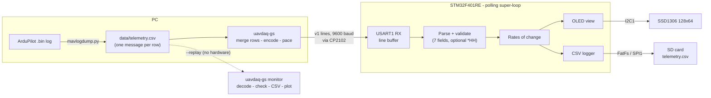

# UAV-DAQ - STM32 flight-telemetry decoder, display and logger

[](https://github.com/Kavin-Re/UAV-DAQ/actions/workflows/ci.yml)
[](LICENSE)


An STM32F401RE (NUCLEO-F401RE) receives drone telemetry as text lines over a
UART, shows altitude, ground speed, battery voltage and their rates of change
on an SSD1306 OLED, and appends every record to a CSV file on an SD card
(FatFs over SPI). A Python ground station replays a recorded ArduPilot flight
log into the board, and can decode, validate, log and plot the same stream on a
PC with no hardware attached.

It started as a university mini-project (October 2025) and is a **bench
prototype**: it has never flown, and it does not read sensors.

## What it is - and what it is not

| | |
|---|---|
| **Data source** | A recorded ArduPilot log (`data/telemetry.csv`, exported with `mavlogdump.py`), replayed from a PC over USB-UART. There are **no sensor drivers** in the firmware. |
| **Link** | 9600 baud, one ASCII line per record, PC -> MCU only. The firmware never transmits. |
| **Timing** | Polling super-loop with blocking OLED and SD updates. Not deterministic, not high-speed, and lines can be lost while the display or card is busy. |
| **Storage** | SD card in **SPI** mode (not SDIO), one open-append-close per record. Logging did not work in the original hardware tests; the cause was found in review and fixed, but the fix has **not been re-tested on hardware**. |
| **Verification** | Host-side unit tests (parser, logger, SD driver against a simulated card) and a hardware-free replay. On-target results are limited to what the original report states - see [Results](#results-and-provenance). |

## Architecture



## Hardware

| Function | Part | Interface | MCU pins (Arduino header) |
|---|---|---|---|
| Controller | ST NUCLEO-F401RE | - | - |
| Telemetry input | CP2102 USB-UART (HW-558A) | USART1, 9600-8-N-1 | PA10 RX (D2), PA9 TX (D8) |
| Display | 0.96 in SSD1306 OLED, 128x64 | I2C1, address 0x3C | PB8 SCL (D15), PB9 SDA (D14) |
| Storage | microSD breakout | SPI1 + GPIO chip select | PB3 SCK (D3), PB4 MISO (D5), PB5 MOSI (D4), PB10 CS (D6) |

Full pin table, block diagram and configuration notes: [docs/HARDWARE.md](docs/HARDWARE.md).

## Quick start

### 1. Replay demo - no hardware, no dependencies

Python 3.10+ is enough (standard library only).

```bash
cd ground_station
python -m uavdaq_gs monitor --replay ../data/telemetry.csv --every 50 --limit 3
```

```text
T 00:01:54  ALT   536.49 m  SPD   0.00 m/s  BAT  24.12 V
T 00:01:55  ALT   537.63 m  SPD   0.00 m/s  BAT  24.14 V
T 00:01:56  ALT   536.79 m  SPD   0.01 m/s  BAT  24.13 V
decoded 3 sample(s); rejected 0 (malformed 0, checksum/CRC 0, overflow 0); ...
```

The file is pushed through the same encoder and decoder that a serial link
would use. Add `--log out.csv` to write the decoded samples,
`--save-plot flight.png` or `--plot` for charts (needs `matplotlib`), and
`--corrupt 0.05 --checksum --require-checksum` to inject bit errors and watch
them being rejected.

### 2. Ground station with the board

```bash
pip install pyserial
cd ground_station
python -m uavdaq_gs stream --port /dev/ttyUSB0 --input ../data/telemetry.csv --every 6
#                                  ^ COM3 on Windows
```

`stream` merges the log rows, formats v1 lines and sends five per second
(`--rate`). `--every 6` thins the roughly 31 rows/s of the log to about real
time. `--dry-run` prints the lines instead of opening a port.

More options: `python -m uavdaq_gs --help`, and
[ground_station/README.md](ground_station/README.md).

### 3. Firmware

The repository holds the application sources and the STM32CubeMX project file,
but **not** the ST HAL, CMSIS, FatFs or the linker script, so a fresh clone
does not build by itself:

1. Open `firmware/STM32 Telemetry.ioc` in STM32CubeIDE / CubeMX and generate code.
2. Replace the generated `FATFS/Target/user_diskio.c` with `firmware/drivers/user_diskio.c`.
3. Enable float `printf` support, build, flash through the on-board ST-LINK.

Details and caveats: [firmware/README.md](firmware/README.md). The logic can be
exercised on a PC without any of that:

```bash
make -C firmware/tests      # gcc + ASan/UBSan, simulated SD card
```

## Telemetry protocol

```
TimeMS,Hour,Min,Sec,Altitude,Speed,Voltage[*HH]\n
114805,0,1,54,536.49,0.00,24.12
```

Seven comma-separated fields, LF-terminated, at most 127 characters; altitude
in m, ground speed in m/s, voltage in V. `*HH` is an optional NMEA-style XOR
checksum. A framed binary **v2** with CRC-16/CCITT-FALSE and sequence numbers
is specified as the next step and already implemented on the Python side
(`--wire v2`). Specification: [docs/PROTOCOL.md](docs/PROTOCOL.md).

## Results and provenance

**Reproducible from this repository** (run on a PC, no hardware):

| Check | Result | How to reproduce |
|---|---|---|
| Ground-station unit tests | 40 tests pass | `cd ground_station && python -m unittest discover -s tests` |
| Firmware logic on host | 126 checks pass (parser/logger 75, SD driver 51) | `make -C firmware/tests` |
| Original SD driver against the same card model | 27 of 51 checks fail | see [docs/FIRMWARE_AUDIT.md](docs/FIRMWARE_AUDIT.md) |
| Sample flight | 72,040 merged records, 38.8 min of log time, altitude 533.5-572.8 m, battery 20.66-24.22 V | `monitor --replay ../data/telemetry.csv` |
| Bit-error injection, 1,441 lines, 5 % of packets hit (seed 0) | plain v1: 15 corrupted records accepted - v1 with checksum: 0 - v2 with CRC: 0 | `monitor --replay ... --every 50 --corrupt 0.05` with and without `--checksum --require-checksum` / `--wire v2` |

**Reported in the original project report** ([docs/legacy](docs/legacy/)) -
measured in October 2025 on an earlier firmware revision (3-field format). No
logs, map files or scope captures were kept, so these cannot be reproduced
from the repository and should be read as indicative:

| Metric | Reported value | Comment |
|---|---|---|
| Telemetry update rate | 5 Hz | This is the send rate set in the PC script, not an MCU capability measurement |
| OLED update latency | ~50 ms | Measurement method not recorded. A full-frame refresh is about 1.1 kB, roughly 100 ms at 100 kHz I2C by calculation. TODO(verify on hardware) |
| CSV parse accuracy | 100 % (about 50 test lines) | Earlier 3-field parser; the committed receive loop had an overrun bug (audit item B1) |
| Flash footprint | ~45 KB | No `.map` / `size` output in the repository. TODO(verify on hardware) |
| RAM utilisation | ~3 KB | Same |
| SD logging | Not working (`f_mount` -> `FR_DISK_ERR`) | Root cause identified and fixed in review; awaiting hardware re-test |

## Repository layout

```
firmware/
  Core/              application (main.c, telemetry.c), SSD1306 driver, CubeMX-generated glue
  drivers/           user_diskio.c - SD card over SPI for FatFs
  tests/             host-side unit tests, HAL/FatFs stubs, SD card simulator
  STM32 Telemetry.ioc, Makefile, README.md
ground_station/
  uavdaq_gs/         protocol codecs, log readers, CLI (stream / monitor / convert)
  tests/             unittest suite
data/
  telemetry.csv          mavlogdump export of one flight (AHR2.Alt, XKF1.VN/VE, BAT.Volt)
  telemetry_stream.csv   the same flight in the legacy 3-column format
docs/
  PROTOCOL.md  HARDWARE.md  FIRMWARE_AUDIT.md
  legacy/            original university reports and ASCII schematics
.github/workflows/ci.yml
```

## Limitations

* Replayed data only - no IMU, barometer, GPS or ADC is read by the MCU.
* Polling reception with blocking display and storage: line loss under load,
  no timing guarantees, maximum reliable rate not characterised.
* One-way link at 9600 baud without acknowledgement; v1 integrity protection is
  an optional 8-bit XOR.
* The firmware changes made during the audit (receive loop, parser, SD driver,
  reconstructed peripheral init) are verified on a PC only.
* The firmware does not build from a clean clone; CI therefore runs host tests
  and static analysis rather than a cross-compile.
* Breadboard wiring, USB-powered, no enclosure, no vibration or environmental testing.
* Only SDv2/SDHC cards are expected to work; no CRC on SD data.

## Roadmap

- [ ] Re-test on hardware: receive loop, SD logging end to end, timing measurements with a scope
- [ ] Make the firmware build reproducible (vendor or submodule STM32CubeF4, commit linker script, cross-compile in CI)
- [ ] Interrupt/DMA UART reception into a ring buffer; buffered SD writes
- [ ] Protocol v2 decoder in C, status frames back to the PC, higher baud rate
- [ ] Real sensors (IMU and barometer over I2C/SPI) so that it becomes a data-acquisition unit rather than a replay target
- [ ] RTC timestamps, log file rotation, card-full handling
- [ ] Move to an RTOS task split (acquire / log / display) once reception is interrupt-driven

## Third-party code

* `firmware/Core/Src/ssd1306*.c`, `firmware/Core/Inc/ssd1306*.h` -
  [afiskon/stm32-ssd1306](https://github.com/afiskon/stm32-ssd1306), MIT licence.
* CubeMX-generated files (`stm32f4xx_*`, `system_stm32f4xx.c`, start-up code,
  `syscalls.c`, `sysmem.c`) - copyright STMicroelectronics, under the terms in
  their file headers.

## Licence

MIT - see [LICENSE](LICENSE).

## Author

**Kavin K K** ([@Kavin-Re](https://github.com/Kavin-Re)) - B.Tech Electronics Engineering (VLSI), Rashtriya Raksha University -
[LinkedIn](https://www.linkedin.com/in/kavinkk-vlsi-embedded)
