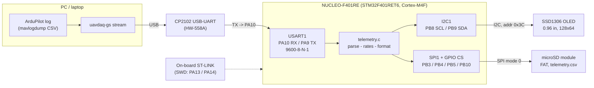
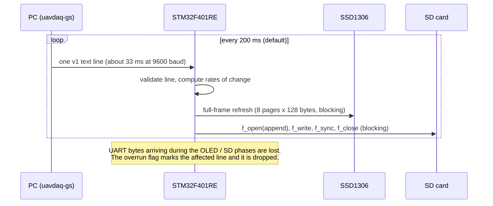

# Hardware

Bench prototype on a solderless breadboard: a NUCLEO-F401RE with three modules.
This page replaces the ASCII documents in [`legacy/`](legacy/); pin assignments
were cross-checked against `firmware/STM32 Telemetry.ioc` and
`firmware/Core/Src/stm32f4xx_hal_msp.c`.

## Block diagram

## Pin table

| Signal | MCU pin | Alternate function | Arduino header | Connects to | Direction (MCU view) |
|---|---|---|---|---|---|
| USART1_RX | PA10 | AF7 | D2 | CP2102 **TX** | in |
| USART1_TX | PA9 | AF7 | D8 | CP2102 **RX** | out (configured, never used by the firmware) |
| I2C1_SCL | PB8 | AF4, open drain | D15 | OLED SCL | out |
| I2C1_SDA | PB9 | AF4, open drain | D14 | OLED SDA | bidirectional |
| SPI1_SCK | PB3 | AF5 | D3 | SD module CLK | out |
| SPI1_MISO | PB4 | AF5 | D5 | SD module MISO (DO) | in |
| SPI1_MOSI | PB5 | AF5 | D4 | SD module MOSI (DI) | out |
| SD chip select | PB10 | GPIO push-pull, idle high | D6 | SD module CS | out |
| SWDIO / SWCLK | PA13 / PA14 | SYS | - | On-board ST-LINK | debug |
| User button B1 | PC13 | EXTI falling edge (configured, unused) | - | On-board button | in |
| 3V3 | - | - | 3V3 | OLED VCC, SD VCC | power |
| GND | - | - | GND | OLED, SD module, CP2102 | common ground |

Notes:

* TX and RX cross over: adapter TX goes to MCU RX. The legacy report lists a
  swapped pair as one of the bring-up faults.
* PB3 is also the SWO trace pin routed to the ST-LINK on this board; SWO trace
  cannot be used together with the SD card.
* No pull resistors are enabled on the MCU side (`GPIO_NOPULL` everywhere). The
  I2C bus relies on the pull-ups of the OLED module, and PA10 floats when the
  USB-UART adapter is unplugged. TODO(verify on hardware): check that the
  modules provide pull-ups on SDA/SCL and on SD MISO.
* Only the header positions in this table were verified. The legacy pinout
  lists further "unused" header pins incorrectly - see
  [`legacy/README.md`](legacy/README.md).

## Peripheral configuration

| Peripheral | Setting | Source |
|---|---|---|
| System clock | 16 MHz HSI, PLL not used, all bus prescalers /1 | `.ioc` (`RCC.SYSCLKFreq_VALUE=16000000`) |
| USART1 | 9600 baud, 8-N-1, no flow control, polled | `.ioc` |
| I2C1 | 7-bit addressing, OLED at `0x3C`; 100 kHz standard mode | address: `ssd1306_conf.h`; speed: legacy docs (not stored in the `.ioc`) |
| SPI1 | Master, 8-bit, CPOL 0 / CPHA 0, MSB first, software CS | `.ioc` + `main.c` |
| SPI1 clock | PCLK2/256 = 62.5 kHz while initialising the card, PCLK2/2 = 8 MHz afterwards | `drivers/user_diskio.c` |
| FatFs | "User-defined" disk I/O driver (`drivers/user_diskio.c`) | `.ioc` |
| SysTick | 1 ms HAL tick | `.ioc` |

The legacy documents state an 84 MHz PLL clock. The `.ioc` in the repository
does not select it, and the SPI rates the same documents quote (62.5 kHz,
8 MHz) correspond to 16 MHz. TODO(verify on hardware). If the clock is raised
to 84 MHz the SD "fast" prescaler must change: PCLK2/2 would be 42 MHz, above
the 25 MHz default-speed limit of SD cards.

## Bill of materials

| Item | Part | Interface | Notes |
|---|---|---|---|
| MCU board | ST NUCLEO-F401RE | - | STM32F401RET6, 512 KB flash, 96 KB RAM, on-board ST-LINK/V2-1 |
| Display | 0.96 in SSD1306 OLED module, 128x64 | I2C | 3.3 V |
| Storage | microSD breakout (SPI) | SPI | 3.3 V logic; card formatted FAT32 |
| USB-UART | HW-558A (Silicon Labs CP2102) | UART | 3.3 V logic levels |
| Misc | Breadboard, jumper wires | - | - |

(The legacy documents quote 256 KB flash / 64 KB RAM, which is the STM32F401xC
variant; the RE part has 512 KB / 96 KB.)

## Power

Everything is supplied from the Nucleo's 3.3 V rail, the board itself from USB.
The legacy documents contain a power budget (about 200 mA worst case) built
from typical datasheet figures; no current measurement is recorded in the
repository. TODO(verify on hardware) before running from a battery.

## Signal flow

